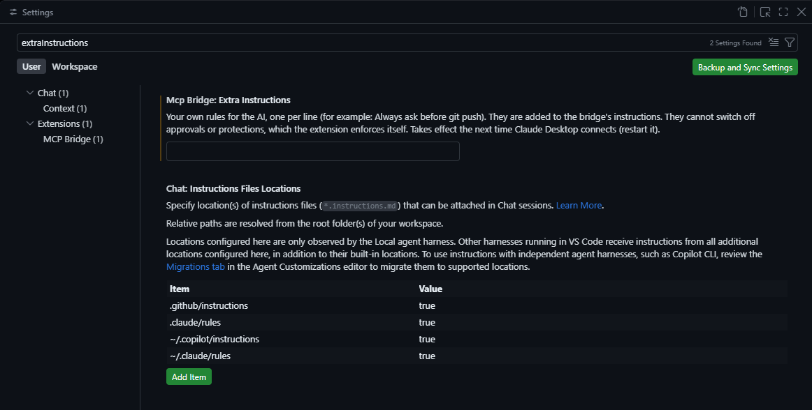

# MCP Bridge for VS Code

[](https://github.com/prateeksingh0/mcp-bridge-vscode/actions/workflows/test.yml)
[](LICENSE)

Let an AI assistant such as **Claude Desktop** work inside your VS Code. It can read and edit files, run commands in a terminal you can watch, use git, see language-server errors and more. Risky actions need your approval.

> Not affiliated with or endorsed by Anthropic. It works with Claude Desktop through the open Model Context Protocol (MCP).

```
Claude Desktop  --stdio-->  shim  --localhost + token-->  this extension (inside VS Code)
```

## Read this first: risks

This extension gives an AI assistant real control of your VS Code. It can read and change files, run shell commands, use git and GitHub, change settings and install extensions. That is powerful, and it can go wrong:

- The AI can make mistakes and break or delete things.
- **Prompt injection:** text inside a file, web page or issue can try to trick the AI into doing something you did not ask for.
- Approvals reduce the risk but do not remove it. [How approvals work](#how-approvals-work) says exactly what is and is not enforced.

Recommendations: use it in projects under version control, keep approvals on, never pick "Always allow" for risky tools in Claude Desktop, only trust folders you trust, and look at the [audit log](#safety-features) now and then. The software is provided as is, with no warranty (see [LICENSE](LICENSE)).

## Contents

[Features](#features) · [Requirements](#requirements) · [Install](#install) · [Connect to Claude Desktop](#connect-to-claude-desktop) · [Check that it works](#check-that-it-works) · [Using it](#using-it) · [How approvals work](#how-approvals-work) · [Safety features](#safety-features) · [Rules for the AI](#rules-for-the-ai) · [Settings](#settings) · [Commands](#commands) · [Tools](#tools) · [Troubleshooting](#troubleshooting) · [Uninstall](#uninstall) · [FAQ](#faq) · [Known limits](#known-limits) · [Development](#development)

## Features

- **56 tools:** files, search, a live terminal, git and the GitHub CLI, errors and navigation from language servers, tasks, debugging, extensions, settings and any VS Code command.
- **Every command runs in a visible VS Code terminal, with no hidden processes.** That includes git, the GitHub CLI and virtualenv commands. Each terminal is titled after its command (for example `MCP: git status`) and keeps its history. The only program started outside a terminal is VS Code itself, when the shim has to open it because it is closed. A test fails if hidden-process code is ever added.
- **Approvals:** risky actions need an Approve in chat, and the riskiest also need a confirmation box in VS Code.
- **Safety:** a pause switch, an audit log, secret redaction and protected paths.
- **Several windows:** each VS Code window registers itself, and any tool can pick one with `target`.
- **Tidy by design:** files the bridge creates are tracked, and leftovers can be cleaned up with your approval.
- **Your own rules:** add rules for the AI in a setting.
- **Local only, no telemetry.** It listens on `127.0.0.1` and sends nothing anywhere.
- **No Node.js needed:** Claude Desktop starts the bridge's small script with VS Code's own built-in runtime.
- Tools stay off in Restricted Mode (untrusted folders).

## Requirements

- VS Code 1.93 or newer.
- Claude Desktop.
- Nothing else. By default the bridge's small script (the "shim") runs on VS Code's own runtime. If you set `mcpBridge.shimRuntime` to `node`, Node.js must be on your PATH.

Tested on Windows 11. The macOS and Linux code paths are written, and the unit tests run on both in CI, but the extension has not been tested live there yet.

## Install

The extension is not on the VS Code Marketplace. Install it from the `.vsix` file.

**From a GitHub Release**

1. Download `mcp-bridge-vscode-<version>.vsix` from the [Releases page](https://github.com/prateeksingh0/mcp-bridge-vscode/releases).
2. Install it, either from a terminal:
   ```
   code --install-extension mcp-bridge-vscode-<version>.vsix
   ```
   or in VS Code: Extensions view, the `...` menu, **Install from VSIX...**.
3. Reload VS Code (`Ctrl+Shift+P`, then **Developer: Reload Window**).

**From source**

```
git clone https://github.com/prateeksingh0/mcp-bridge-vscode.git
cd mcp-bridge-vscode
npx @vscode/vsce package
code --install-extension mcp-bridge-vscode-<version>.vsix
```

You should now see **MCP Bridge** in the bottom-right status bar of VS Code.

## Connect to Claude Desktop

1. Press `Ctrl+Shift+P` and run **MCP Bridge: Connect to Claude Desktop**.
2. A box shows the exact Claude Desktop config file it found. Check the path and click **Update**.
3. **Fully quit** Claude Desktop (tray icon, Quit) and reopen it. Start a **new chat**.

What the command does: it finds `claude_desktop_config.json`, saves a `.bak` copy next to it, and adds one entry named `vscode-bridge`. It refuses any file that is not named `claude_desktop_config.json`, and it never touches your other servers. If it cannot find the file, it asks you to pick it.

To undo it, run **MCP Bridge: Disconnect from Claude Desktop**. It removes only its own entry.

## Check that it works

1. In a new chat, the tools menu should list **vscode-bridge**.
2. Ask: "Use vscode-bridge to show my workspace." It should name the folder open in VS Code.
3. Optional: ask "What is the vscode-bridge check phrase?" If the answer is `copper-lantern-4821`, Claude Desktop is passing the bridge's instructions to the AI.

## Using it

Just ask in plain language. For example:

- "Create a Python virtual environment in this folder, install requests, and run main.py."
- "Show me git status, then commit everything with the message 'Fix typo'."
- "Where is `parse_config` defined? Show me every place it is used."
- "Rename this function everywhere, then check for errors."

What you will see:

- **Commands** run in terminals titled after the command, for example `MCP: git status`. The bridge keeps at most three terminals (default `main`, `tools`, and one for a long-running job) and reuses them.
- **Files** the AI edits open in the editor, so you can watch and undo.
- **Risky actions** show an approval card in the chat, and for the riskiest a confirmation box in VS Code.
- **Several windows:** by default the most recently focused window is used. Ask the AI to call `list_windows`, or give a folder as `target`, to choose another.

## How approvals work

Risky tools reply `APPROVAL_REQUIRED`. The AI must then call `request_approval` with the exact action and show you an approval card in the chat (Approve / Deny). The approval is tied to those exact arguments, works once and expires after 10 minutes.

| Action | What is required |
| --- | --- |
| Delete a file or folder, clean up session files, install or uninstall an extension, run an arbitrary VS Code command, risky git commands (push, reset, clean, rebase, restore...), `gh` commands that change things, dangerous shell patterns, a terminal command that refers to a protected file, any file tool touching a protected path | Approval in chat **and** a VS Code confirmation box |
| Writing outside your workspace folders, changing a user-level setting | Approval in chat |
| Everything else | Nothing from the bridge, but Claude Desktop shows its own "Needs approval" prompt for tools marked as destructive, such as `terminal_run` |

Be aware of the limits:

- The chat approval depends on the AI following the server's instructions. **The VS Code confirmation box is the part that cannot be skipped**, so the highest-risk actions always get one.
- Ordinary terminal commands are not blocked by the bridge. A short list of dangerous patterns, and commands that obviously name a protected file, are gated. Claude Desktop's own approval prompt is your main protection for everything else.
- The setting `mcpBridge.approvalMode` changes this: `chat-and-vscode` (default), `chat-only`, `vscode-only` or `off`.

## Safety features

- **Pause switch:** click **MCP Bridge** in the status bar to pause or resume AI access. While paused, every tool except `get_workspace` is refused. The pause is remembered for that folder across window reloads, and VS Code reminds you when a window starts paused.
- **Audit log:** every call, including refused ones, is written as one JSON line to `~/.mcp-bridge/audit.log` (rotated at 5 MB). File contents and approval IDs are logged as sizes only. Open it with **MCP Bridge: Show Audit Log**.
- **Secret redaction:** tool output is scrubbed before the AI sees it: private keys, AWS, GitHub, GitLab, Slack, Google, Stripe, npm and `sk-` style keys, JWTs, Bearer tokens, passwords inside URLs and `password = ...` style values. It is a heuristic: it can miss secrets and can mask harmless values. Turn it off with `mcpBridge.redactSecrets`.
- **Protected paths:** `.ssh`, `.aws`, `.gnupg`, `.kube`, `.env` files (not `.env.example`), `*.pem`, `*.key`, `credentials.json`, the Claude Desktop config and the bridge's own window registry need full approval even to read. Terminal commands that obviously name such a file are gated too, on a best-effort basis. `git_commit`, and broad commands such as `git add .` or `git commit -a`, refuse to run if they would stage a protected file. Add your own patterns with `mcpBridge.protectedPaths`.
- **Trusted folders only:** in Restricted Mode the tools are disabled. In an untrusted window the status bar says "restricted" and offers to trust the folder.
- **Local only:** the bridge listens on `127.0.0.1` with a random per-window token. The tokens are stored in `~/.mcp-bridge/windows/`, so any program running as your user could read them.
- **Reversible by default:** deletes go to the trash, and `checkpoint` saves a restorable git snapshot before big edits.

## Rules for the AI

The bridge tells the AI how to behave in your VS Code. There are four layers, because not every client passes server instructions to the model:

1. **Enforced by the extension** (works whatever the AI does): approvals, pause, protected paths, secret redaction, and every command running in a visible terminal.
2. **Rules inside the tool descriptions.** The AI always sees these, for example "delete temporary files you create" on the file tools.
3. **The instructions**, written to `~/.mcp-bridge/instructions.txt` and sent when Claude Desktop connects. The AI can also read them on demand with the `get_instructions` tool.
4. **Your own rules** (next section).

**Keeping the workspace clean.** The bridge remembers files and folders it creates, and new items that terminal commands create in their folder. `list_session_files` shows what is left, and `cleanup_session` moves the ones you approve to the trash. It refuses any path the bridge did not record. Files you asked for on purpose are marked with `keep_session_files`, so they stop being listed as leftovers (nothing is deleted).

### Set your own rules

You can add rules in your own words, such as "Ask me before running git push" or "Use pnpm, not npm". They are saved in your VS Code **user** settings.

**Where to set them**

1. Open Settings with `Ctrl+,` (macOS: `Cmd+,`) and stay on the **User** tab.
2. Search for `extraInstructions`. The setting is called **Mcp Bridge: Extra Instructions**.
3. Type one rule per line.



Or edit `settings.json` directly. Press `Ctrl+Shift+P`, run **Preferences: Open User Settings (JSON)**, and add:

```json
"mcpBridge.extraInstructions": "Ask me before running git push\nUse pnpm, not npm\nReply in short bullet points"
```

The file lives at `%APPDATA%\Code\User\settings.json` on Windows, `~/Library/Application Support/Code/User/settings.json` on macOS and `~/.config/Code/User/settings.json` on Linux.

**Make it take effect.** VS Code updates the bridge's instructions file straight away, but Claude Desktop only reads it when it connects. Fully quit and reopen Claude Desktop, then start a new chat.

**Check that it worked.** Open `~/.mcp-bridge/instructions.txt`: your lines appear at the end, under **USER RULES**. Or ask the AI in a new chat what rules the vscode-bridge server gave it.

**Good to know**

- It has to be a user setting. The setting is machine-scoped, so a project you open cannot add rules to your AI.
- Up to 30 rules of 300 characters each. Short, specific rules work best.
- Your rules are requests, not locks. They cannot switch off approvals, pause or protected paths, which the extension enforces itself. For a hard block, use `mcpBridge.protectedPaths` or `mcpBridge.approvalMode`.

## Settings

The security-related settings are machine-scoped (user settings only), so a project's own `.vscode/settings.json` cannot weaken them.

| Setting | Default | Meaning |
| --- | --- | --- |
| `mcpBridge.approvalMode` | `chat-and-vscode` | How risky actions are approved: `chat-and-vscode`, `chat-only`, `vscode-only` or `off` (user only) |
| `mcpBridge.allowedRoots` | `[]` | Extra folders where writes need no approval (user only) |
| `mcpBridge.allowInUntrustedWorkspace` | `false` | Let tools run in Restricted Mode. Not recommended (user only) |
| `mcpBridge.redactSecrets` | `true` | Mask secrets in tool output (user only) |
| `mcpBridge.protectedPaths` | `[]` | Extra protected paths or patterns, `*` is a wildcard (user only) |
| `mcpBridge.shimRuntime` | `vscode` | `vscode` runs the shim on VS Code's own runtime (no Node needed). `node` uses Node from PATH (user only) |
| `mcpBridge.extraInstructions` | empty | Your own rules for the AI, one per line (user only) |
| `mcpBridge.maxTerminals` | `3` | Maximum terminals the bridge keeps open |
| `mcpBridge.idleMinutes` | `30` | Close idle bridge terminals after this long |

`mcpBridge.shimRuntime` applies the next time you run **Connect to Claude Desktop**.

## Commands

Press `Ctrl+Shift+P` and type "MCP Bridge":

- **MCP Bridge: Connect to Claude Desktop**
- **MCP Bridge: Disconnect from Claude Desktop**
- **MCP Bridge: Pause / Resume AI Access** (also the status bar item)
- **MCP Bridge: Show Log**
- **MCP Bridge: Show Audit Log**

## Tools

| Area | Tools |
| --- | --- |
| Windows and workspace | `list_windows`, `get_workspace`, `open_folder`, `get_instructions` |
| Files | `list_files`, `find_files`, `read_file`, `write_file`, `append_file`, `edit_file`, `create_dir`, `move_path`, `copy_path`, `delete_path` (to the trash), `search` |
| Editor | `open_file`, `get_active_editor`, `save_all`, `format_document` |
| Code intelligence | `get_diagnostics`, `go_to_definition`, `find_references`, `hover`, `document_symbols`, `workspace_symbols`, `rename_symbol` |
| Terminal | `terminal_run`, `terminal_read`, `terminal_interrupt`, `terminal_close`, `terminal_list` |
| Python | `python_create_venv`, `python_use_venv` |
| Git and GitHub | `git_status`, `git_diff`, `git_log`, `git_commit`, `checkpoint`, `git`, `gh` |
| VS Code | `extension_list`, `extension_install`, `extension_uninstall`, `get_setting`, `update_setting`, `list_vscode_commands`, `run_vscode_command`, `list_tasks`, `run_task`, `debug_start`, `debug_stop` |
| Safety and cleanup | `request_approval`, `list_session_files`, `keep_session_files`, `cleanup_session` |
| Speed | `batch` runs several tools in one call |

Every tool carries safety hints (read-only, or destructive for the risky ones), so Claude Desktop can ask for approval in the right places.

## Troubleshooting

- **No tools in Claude Desktop, or the server shows as failed.** Fully quit and reopen Claude Desktop after connecting, start a new chat, and check the status bar shows **MCP Bridge**. If it still fails, set `mcpBridge.shimRuntime` to `node` in your user settings, run **Connect to Claude Desktop** again and restart Claude Desktop. That needs Node.js on your PATH.
- **After updating the extension:** reload VS Code and restart Claude Desktop. A chat that was open before the update keeps its old tool list, so start a new chat.
- **The status bar says "restricted".** The folder is in Restricted Mode. Click it and choose Trust.
- **The status bar says "paused".** Click it to resume.
- **Wrong window.** Call `list_windows`, then pass `target` (a folder path or process id). By default the most recently focused window is used.
- **"Output NOT captured".** VS Code's shell integration had not started in that terminal, which can happen right after a window opens. The command still ran. Check the terminal or verify through files.
- **The AI keeps asking for approval.** Approvals work once and expire after 10 minutes. Check `mcpBridge.approvalMode`.
- **Connect cannot find your Claude Desktop config.** Choose the file by hand when asked. It must be named `claude_desktop_config.json`. The command also offers to repair the entry if VS Code was moved or reinstalled.
- **Windows PowerShell 5.1** (the default shell on Windows): chain commands with `;` instead of `&&`.
- **Where are the logs?** **MCP Bridge: Show Log** for the extension, and **Show Audit Log** for every call.

## Uninstall

1. Run **MCP Bridge: Disconnect from Claude Desktop** and restart Claude Desktop.
2. Uninstall the extension: `code --uninstall-extension local.mcp-bridge-vscode`.
3. Delete the `.mcp-bridge` folder in your home folder.

## FAQ

**Does it send my data anywhere?** The bridge itself sends nothing and has no telemetry. It only listens on your own machine. Whatever a tool returns goes to the AI assistant you are talking to, which is why secret redaction and protected paths exist.

**Can I use it with other AI apps?** The shim speaks standard MCP over stdio, so apps that can start a local MCP server may work, but only Claude Desktop has been tested. Apps that accept only remote HTTPS servers cannot use it.

**Does it work on macOS and Linux?** The code is written for them and the unit tests run on both in CI, but it has not been tested live there. If you try it, please open an issue with your results.

**Why not the Marketplace?** It is a personal project shared on GitHub. Install the `.vsix` from a Release.

## Known limits

- The chat approval depends on the AI following the server's instructions. The VS Code confirmation box is the part it cannot skip.
- Terminal commands are not sandboxed. The check for protected paths inside commands is best effort and cannot catch every trick (variables, wildcards, built-up strings).
- Secret redaction is a heuristic.
- Files created by terminal commands are tracked only when they appear directly in the command's folder.
- The per-window tokens can be read by any program running as your user.
- The shim starts VS Code itself when it is closed, outside a terminal.
- Not tested live on macOS or Linux.

See [SECURITY.md](SECURITY.md) for how to report a problem privately.

## Development

```
node --test                       # unit tests, including a test that runs the shim itself
npx @vscode/vsce package          # build the .vsix
```

- `extension.js`: the VS Code side (tools, approvals, status bar, commands)
- `shim.js`: the MCP server that Claude Desktop runs over stdio
- `safety.js`, `claudeconfig.js`, `termutil.js`, `search.js`, `runner.js`, `ledger.js`, `rules.js`, `commitguard.js`: helpers with tests in `test/`

CI runs the tests on Windows, macOS and Linux for every push. To make a release, update the version in `package.json` and `CHANGELOG.md`, then push a tag such as `v0.7.0`. The release workflow builds the `.vsix` and attaches it to a GitHub Release.

See [CONTRIBUTING.md](CONTRIBUTING.md) and [CHANGELOG.md](CHANGELOG.md).

## License

MIT. See [LICENSE](LICENSE).
